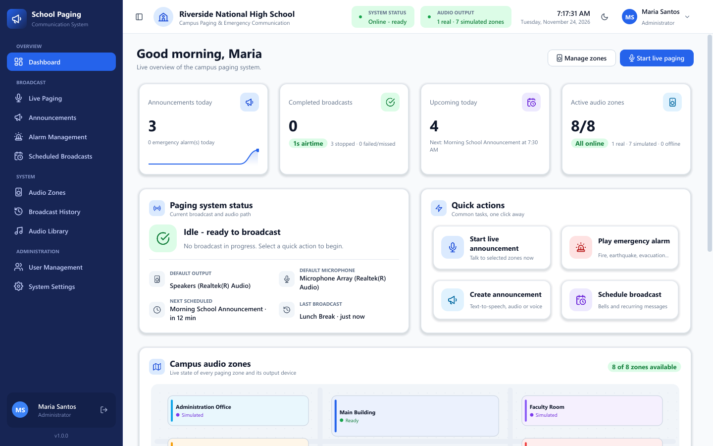
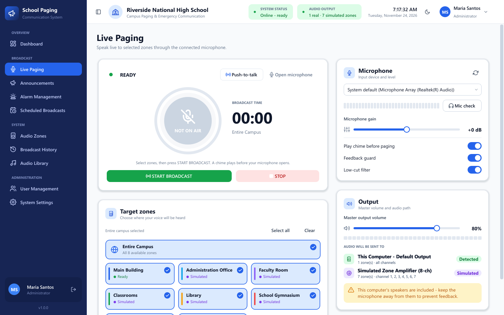
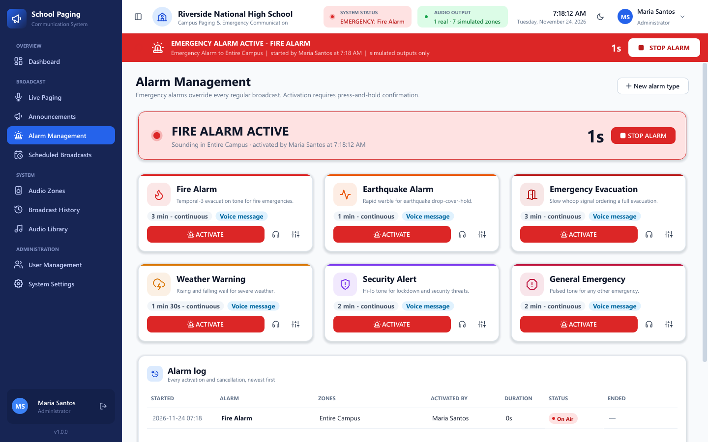
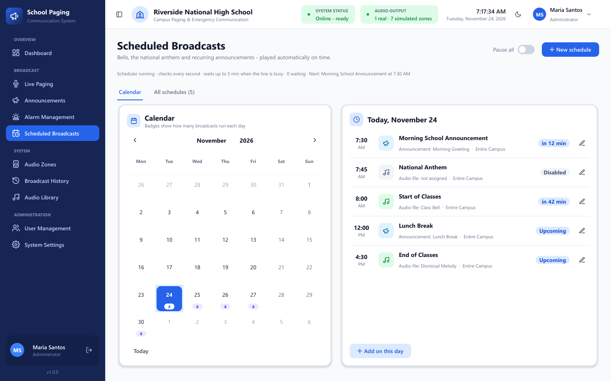
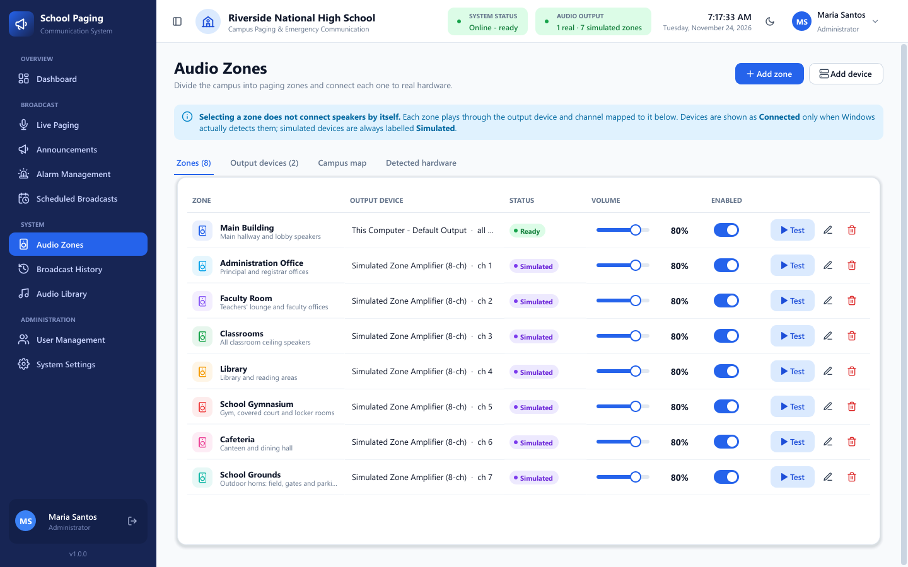

# School Paging & Announcement Management System

A Windows desktop application for school-wide paging: live microphone announcements,
emergency alarms with priority override, scheduled bells and announcements, audio zones mapped to
real hardware, a central audio library and a complete broadcast history, all behind role-based
access control.

Built with **Python 3.11+**, **PySide6 (Qt 6)**, **sounddevice/PortAudio**, **SQLite** and **ReportLab**.



| Live paging | Emergency alarm active |
|---|---|
|  |  |
| **Scheduled broadcasts** | **Audio zones & hardware** |
|  |  |

---

## Features

| Module | Highlights |
|---|---|
| **Dashboard** | Today's broadcasts, completions, upcoming schedule, zone health, live system status, quick actions, animated campus zone map, recent activity, 7-day chart |
| **Live Paging** | Real microphone → speaker streaming, microphone selection, mic gain and master volume, live level meters, push-to-talk (button **or Space bar**) or open-mic mode, intro chime when the microphone opens and **outro chime when you press STOP** (press STOP again to cut it short), broadcast timer, safety auto-stop, interrupt confirmation, feedback guard and low-cut filter |
| **Announcements** | Text-to-speech (Windows SAPI + OneCore voices, speed and volume), uploaded audio, in-app voice recording, 8 categories, target zones, **intro and outro chimes** (per announcement), repeat options, local preview, approval workflow for operators |
| **Alarm Management** | Fire, Earthquake, Evacuation, Weather, Security, **Shooting Incident** (lockdown) and General alarms with synthesized signals (temporal-3, slow whoop, hi-lo, lockdown yelp...), spoken instructions between siren cycles, custom sounds and alarm types, duration and repetition, **press-and-hold activation**, optional password re-entry, red emergency state on every screen, full alarm log |
| **Scheduled Broadcasts** | Play an announcement, **the schedule's own text-to-speech message or recorded voice**, an audio file or an alarm drill, with optional intro/outro chimes; once / daily / weekdays / weekly / every-N-weeks schedules with end dates, month calendar with counts, day agenda, run-now, enable/disable, global pause, **overlap prevention**, automatic execution with a grace period for busy lines and "missed" records |
| **Audio Zones** | Zones mapped to configured output devices and channels, enable/disable, per-zone volume, test tones per zone or device, drag-and-drop campus map, detected-hardware view, hot-plug detection |
| **Broadcast History** | Every broadcast (including failed and missed ones) with type, user, zones, duration and status, search and filters, details view, **CSV and PDF export** |
| **Audio Library** | Upload (or drag and drop) MP3/WAV/FLAC/OGG/AIFF, preview, rename, categories, assign to announcements or alarms, protected built-in sounds |
| **User Management** | Administrator / School Personnel / Operator roles, editable role permissions, per-user extra permissions, activation, password reset, lockout, searchable activity log with CSV export |
| **System Settings** | School name and logo, audio interface and default devices, latency, intro and outro chime sounds, zone volumes, TTS defaults, alarm safeguards, theme (light/dark), start with Windows, tray behavior, auto sign-out, password policy, backup and restore, database location and integrity check |

## Quick start

Requirements: Windows 10 or 11 (64-bit) and Python 3.11 or newer.

```powershell
py -3 -m venv .venv
.\.venv\Scripts\python.exe -m pip install -r requirements.txt
.\.venv\Scripts\python.exe main.py
```

Or double-click `run.bat` after installing the requirements.

On first start a **setup screen** asks for the school name and creates the administrator account.
Two options are offered:

* **Sample content**: demo announcements and the example daily schedule (07:30 morning announcement,
  07:45 national anthem (disabled until you upload it), 08:00 start of classes, 12:00 lunch, 16:30 end of
  classes).
* **Local output**: plays the *Main Building* zone through this computer's speakers. All other zones start on
  a clearly labelled **simulated** 8-channel amplifier until you map them to real hardware.

Command-line options:

| Option | Purpose |
|---|---|
| `--data-dir PATH` | Use another data folder (testing, multiple sites) |
| `--simulated-audio` | Never open real audio devices (demo/training mode) |

## Running the tests

```powershell
.\.venv\Scripts\python.exe -m pytest
```

60 tests cover the database, authentication and lockout, role permissions, audio DSP and the output engine,
emergency priority rules, schedule recurrence and conflicts, the scheduler (including busy → missed),
exports, backup/restore and UI smoke tests of every page and dialog (rendered offscreen).

## Building the Windows executable

```powershell
powershell -ExecutionPolicy Bypass -File build.ps1
```

This runs the tests, then PyInstaller (`school_paging_system.spec`), producing
`dist\SchoolPagingSystem\SchoolPagingSystem.exe` and a zip for distribution. The build is a folder (*onedir*)
bundle: fast start-up, no installer required. Copy the whole folder to the target PC.

---

## Architecture

```
main.py                     entry point: single-instance guard, sign-in ↔ main window
core/                       business logic (no widgets)
  app_context.py            composition root - creates and wires every service
  authentication.py         scrypt password hashing, sign-in, lockout, permission checks
  user_manager.py           users and roles with safeguards (last admin, self-lockout)
  permissions.py            permission catalogue and default roles
  paging_manager.py         BroadcastController - priority arbitration, live paging, history
  announcement_manager.py   announcements, TTS/file/recording rendering, approval
  alarm_manager.py          alarm types, siren + voice programs, activation
  schedule_manager.py       recurrence rules, conflict detection, execution
  zone_manager.py           zones, devices, live hardware status, zone → endpoint routing
  audio_manager.py          audio library, built-in sounds, uploads, recordings
  history_manager.py        history queries, statistics, exports
  backup_manager.py         zip backups, staged restore, database relocation
  settings_manager.py       typed settings with defaults
  activity_logger.py        audit trail
database/                   SQLite: connection wrapper, versioned migrations, models, repositories
services/                   audio and infrastructure
  device_detection.py       PortAudio device enumeration, hot-plug probing
  audio_engine.py           fans one source out to every endpoint; local preview player
  audio_output.py           Windows-device and simulated endpoints, gain ramps, limiter, channel mapping
  audio_input.py            microphone source, push-to-talk gate, feedback guard, recorder
  audio_sources.py          buffers, sequences, repeats, live ring buffers
  audio_decoder.py          decoding (libsndfile), resampling, WAV writing, cache
  network_audio.py          IP speaker integration layer (RTP G.711 driver, SIP/HTTP placeholders)
  sound_generator.py        synthesized chimes, bells and alarm signals
  text_to_speech.py         SAPI 5 / OneCore speech rendered to cached WAV
  scheduler.py              1-second scheduler loop with grace period
  reporting.py              CSV and PDF reports
ui/                         PySide6 pages (one per module) and the application shell
  components/               cards, badges, toggles, hold button, meters, tables, charts, toasts,
                            dialogs, zone selector, campus map, calendar, sidebar, top bar
tests/                      pytest suite
assets/                     icons and images (sounds are generated at run time)
```

### Audio pipeline

```
 source (mic | file | TTS | alarm program)
        │  one reader per endpoint, resampled to the device's own rate
        ├──► Windows device A  (WASAPI stream, channels mapped per zone) ──► amplifier / speakers
        ├──► Windows device B  (USB interface, ch 3-4)                    ──► zone amplifier
        ├──► RTP endpoint      (G.711 mu-law, 20 ms packets)              ──► IP speakers that accept RTP
        └──► simulated endpoint (real-time consumer, no sound)            ──► testing without hardware
```

* Every endpoint runs on its own clock, so devices with different sample rates play the same broadcast
  without drift; live microphone audio is buffered per endpoint with bounded latency.
* Master × zone gain is applied with click-free ramps and a soft limiter.
* A watchdog detects stalled/disconnected devices; a broadcast continues on the remaining outputs and the
  failure is reported and logged.
* PortAudio is only re-initialised for hot-plug rescans when no stream is open.

### Broadcast priority rules

| Situation | Result |
|---|---|
| Nothing on air | Broadcast starts |
| Emergency alarm requested while a regular broadcast is on air | Confirmation, then the alarm interrupts it (requires **Emergency override** permission) |
| Regular broadcast requested during an emergency alarm | **Refused**: regular broadcasts never interrupt alarms |
| Higher-priority manual broadcast (e.g. live page over an announcement) | Confirmation, then interrupt |
| Equal or lower priority | Refused ("on air"); the scheduler waits and retries within the grace period |
| Scheduled broadcast still blocked after the grace period | Recorded as **missed** in history |

Priorities: Emergency alarm 100 > Live paging / Emergency announcement 50 > Announcement / Scheduled 30 >
Zone test 5. Every attempt that reaches the audio layer (including failures) is written to broadcast history.

---

## Hardware integration guide

Selecting a zone **never** implies speakers are connected: each zone is mapped to a configured
**output device** and **channel**. Device status is shown as *Connected* only when Windows actually reports
the device; simulated devices are always labelled *Simulated*.

| Device type | Connection | Typical use |
|---|---|---|
| Local audio output | Windows sound device | PC speakers, line-out to a mixer, HDMI |
| External PA amplifier | Windows sound device (or RTP) | Line-out / USB audio interface feeding a PA amplifier. A multi-channel interface can drive one amplifier zone per channel ("Output channel" on the zone) |
| Network audio adapter | Windows sound device or RTP | Dante/AES67 virtual soundcards appear as Windows devices; RTP receivers can take a G.711 stream |
| IP speaker | RTP / SIP / HTTP | **RTP (G.711 mu-law)** is implemented. SIP paging and vendor HTTP APIs are placeholders that report *Not supported* until a driver for the speaker model is added |
| Simulated | none | Consumes audio silently in real time to test zones without hardware |

**Adding a vendor protocol.** Implement `services.network_audio.NetworkAudioDriver` (`probe()` for honest status
reporting, `create_session()` returning an `OutputSession`), register it in `DRIVERS`, and add the transport to
`TYPE_TRANSPORTS` in `core/zone_manager.py`. RTP compatibility depends on the speaker's configuration (codec,
port, multicast group); multicast delivery cannot be verified from the sender and is shown as *Unverified*.

**Feedback prevention.** Use push-to-talk, keep the microphone away from paged speakers (the console warns when
this computer's speakers are part of the selection), keep the feedback guard on (it lowers mic gain when a
sustained howl is detected) and prefer a headset or desk paging microphone.

## Data, backup and restore

* All data lives in `%LOCALAPPDATA%\SchoolPagingSystem\`: `paging_system.db` (SQLite, WAL mode),
  `library\` (uploaded audio, recordings, generated built-in sounds), `backups\`, `logs\app.log`.
* **Portable mode:** create an empty `portable.flag` file next to the executable and data is stored in
  `.\data` instead.
* **Backups** (`.spsbackup`) contain the database and the audio library. An automatic daily backup keeps the
  last seven copies. **Restore** is staged and applied on restart, and a safety copy of the current database is
  kept first.
* The database location can be changed from *System Settings → Database*.

## Security

* Passwords are stored as salted **scrypt** hashes; accounts lock after repeated failures (configurable).
* Role-based access control on every module **and** in the business layer (UI hiding is not relied upon).

| Role | Default access |
|---|---|
| Administrator | Everything: users, settings, zones and devices, alarms, schedules, history |
| School Personnel | Create announcements, live paging, view history, library uploads (schedule management can be granted) |
| Operator | Live paging and playing approved announcements (alarm triggering can be granted) |

* Every sign-in, broadcast, alarm activation/cancellation and configuration change is written to the
  activity log.

## Known limitations

* Scheduled broadcasts run while the application is running. Keep it in the system tray, and optionally enable
  *Start with Windows*.
* One broadcast at a time across the whole system (by design, preventing conflicting broadcasts).
* Built-in alarm tones follow common evacuation-signal patterns but are **not certified life-safety signals**.
  Integrate with the building's certified fire alarm system where regulations require it.
* IP speaker support is limited to RTP (G.711). SIP and vendor APIs need manufacturer-specific drivers.
* Text-to-speech uses voices installed in Windows (add more under *Settings → Time & language → Speech*).

## Credits

Icons are adapted from [Feather](https://feathericons.com) (MIT) and [Lucide](https://lucide.dev) (ISC).
The dismissal melody uses the traditional, public-domain Westminster Quarters.
